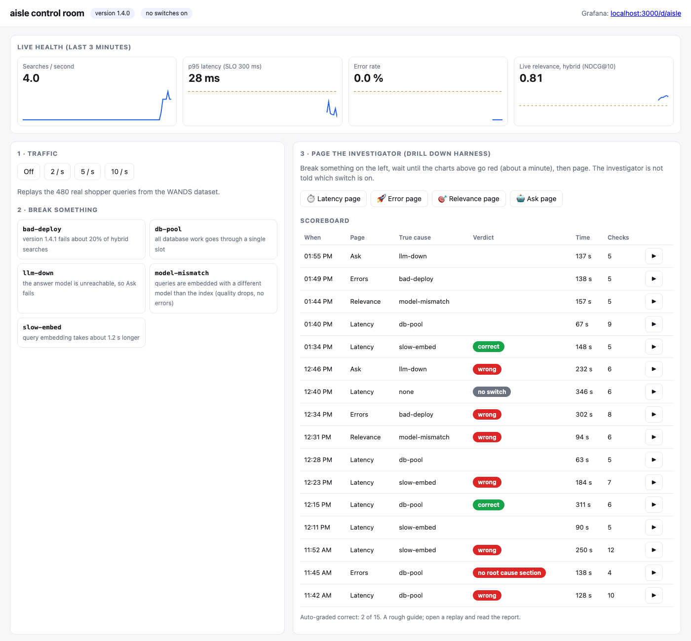
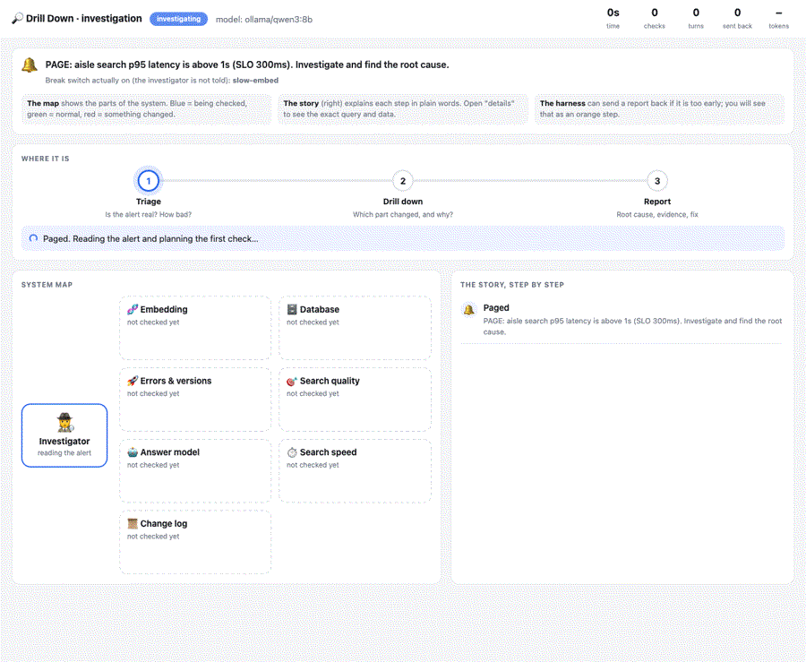
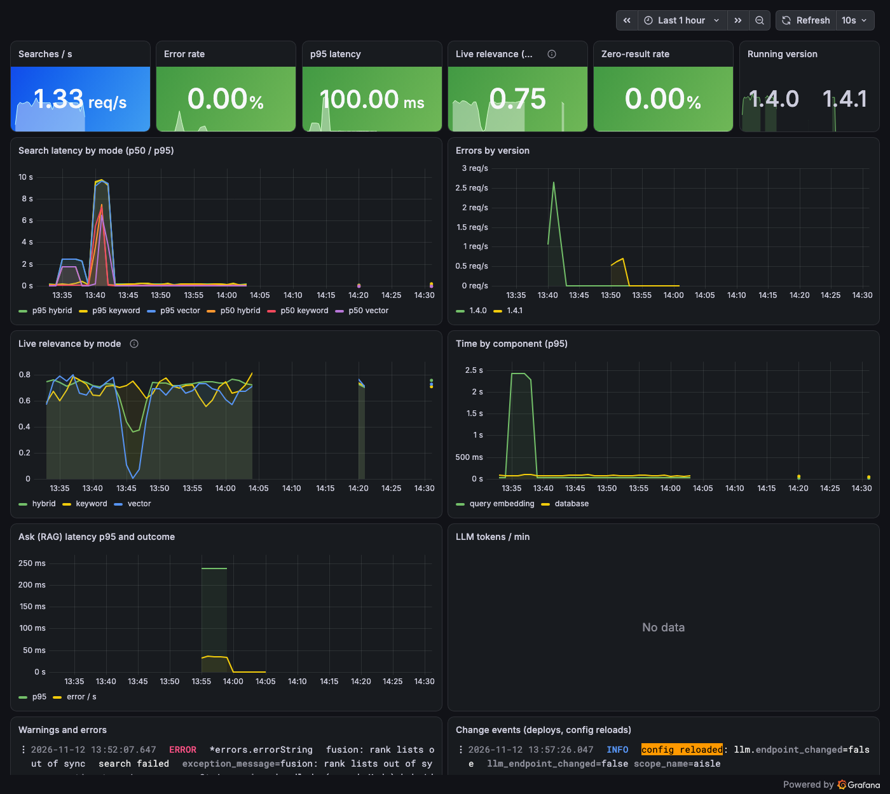

# aisle

Hybrid product search with RAG answers, built to be measured and to be broken.

- **Search**: keyword (Postgres full-text) + meaning (pgvector) merged with Reciprocal Rank Fusion.
- **Ask**: an LLM answers shopping questions from the retrieved products only, and cites them.
- **API**: gRPC + Protobuf, with a small HTTP side door for health checks and quick tests.
- **Scored**: every change is measured against 233K human relevance labels (WANDS dataset).
- **Observable**: traces, metrics and logs through OpenTelemetry into Grafana, Prometheus, Tempo and Loki.
- **Breakable**: five realistic break switches, each investigated by [Drill Down Harness](https://github.com/arsaljamal/drill-down-harness).
- **Free to run**: embeddings and answers from local models via Ollama. Any OpenAI-compatible API also works.

## Scores

<!-- scores:start -->
Measured against 480 real shopper queries and 233K human relevance labels ([details](docs/results.md)).

| Mode | NDCG@10 | First exact hit (MRR) | p95 latency |
|---|---|---|---|
| Keyword | 0.689 | 0.532 | 108 ms |
| Vector | 0.697 | 0.547 | 15 ms |
| **Hybrid** | **0.738** | **0.569** | 105 ms |
<!-- scores:end -->

## Run it

Needs Go 1.25+, Docker and [Ollama](https://ollama.com).

```sh
make demo          # download data, start Postgres + Grafana, pull models, load, embed, score
make serve         # gRPC on :7070, HTTP on :7071, Grafana on http://localhost:3000
make load          # replay real shopper queries at 5 req/s
```

Try it:

```sh
curl 'localhost:7071/search?q=salon+chair'                  # hybrid (default)
curl 'localhost:7071/search?q=salon+chair&mode=keyword'
curl 'localhost:7071/ask?q=a+sturdy+desk+for+a+small+room'
grpcurl -plaintext -d '{"query":"salon chair"}' localhost:7070 aisle.v1.SearchService/Search
```

Settings come from flags or environment variables: `AISLE_DSN`, `AISLE_EMBED_URL`, `AISLE_EMBED_MODEL`,
`AISLE_CHAT_URL`, `AISLE_CHAT_MODEL`, `AISLE_API_KEY` (hosted models only).

## How it works

```
query ─► gRPC Search ─┬─► Postgres full-text (weighted: name > category > description) ─┐
                      └─► embed query ─► pgvector HNSW (cosine) ────────────────────────┴─► RRF ─► top 10
question ─► gRPC Ask ─► hybrid top 8 ─► LLM with numbered products ─► answer + [P123] citations
```

- **Why hybrid**: keyword search is precise on names and model numbers but misses meaning
  ("salon chair" returns office chairs). Vector search gets meaning but blurs exact terms. Fusion keeps both.
- **Why RRF**: the two scores are on different scales. RRF only uses rank, so it needs no tuning.
- **Why one Postgres**: one system for text, vectors and filters. No sync job between a search
  engine and a vector database.
- **Why citations are checked**: the answer may only cite products that were actually retrieved;
  anything else is dropped. That makes every recommendation traceable.
- **Live relevance**: when a live search matches a labelled query, its NDCG@10 is recorded as a metric.
  This stands in for click-through data, so quality is monitored like latency.

## Control room



`aisle serve` also serves a control room at http://127.0.0.1:7071:

1. **Live health**: searches per second, p95 latency, error rate, live relevance.
2. **Traffic and break switches**: replay real shopper queries, then break one part.
3. **Page the investigator**: Drill Down Harness investigates in the viewer below, live. A system map shows
   which part it is checking and what it found (green normal, red changed), a plain-words story explains each
   step, and the report is graded against the switch that was really on.
4. **Scoreboard**: every investigation, with ▶ to replay it.
5. **Search side by side**: keyword, vector and hybrid results, coloured by the human ratings.

```sh
AISLE_INVESTIGATOR="drill run --otlp --events json --config ops/drill-v2.yaml" ./bin/aisle serve
```

The HTTP side door binds to localhost only: it can flip break switches and run the investigator.
For local models, start Ollama with a larger context (`OLLAMA_CONTEXT_LENGTH=32768 ollama serve`):
the default 4K window silently cuts off the investigator's instructions.

## Investigations



Results, hand-graded, with replays of every run: **[docs/incidents.md](docs/incidents.md)**.
Latest: 2 of 5 root causes correct and 1 half right, with a free 8B local model.

## Dashboards

`make up` starts Grafana at http://localhost:3000 with two dashboards: **aisle** (the service) and
**Drill Down Harness** (the investigator itself: runs, outcomes, time, tools, tokens, send-backs).



## Break it

```sh
./bin/aisle break                   # list switches
./bin/aisle break slow-embed        # turn one on
./bin/aisle break slow-embed off
scripts/incident.sh db-pool         # traffic → fault → page the harness → save its report
```

| Switch | What breaks | What an on-call engineer sees |
|---|---|---|
| `slow-embed` | query embedding takes ~1.2 s longer | latency alert |
| `db-pool` | all database work squeezed through one slot | the same latency alert, a different cause |
| `model-mismatch` | queries embedded with a different model than the index | relevance drops, no errors at all |
| `bad-deploy` | version 1.4.1 fails ~20% of hybrid searches | error-rate alert |
| `llm-down` | answer model unreachable | Ask fails, Search is fine |

The service never logs the word "fault". It logs what real systems log (a rollout, a config reload,
a maintenance window), so the investigator has to connect the dots.


## Data

[WANDS](https://github.com/wayfair/WANDS) by Wayfair (MIT licence): 42,994 products, 480 real shopper
queries and 233,448 human relevance labels (Exact / Partial / Irrelevant). Scores use gains 2 / 1 / 0.

## Layout

```
cmd/aisle            ingest, embed, eval, serve, load, break
internal/catalog     WANDS reader
internal/store       Postgres: full-text + pgvector
internal/search      keyword, vector, hybrid (RRF)
internal/rag         answers with checked citations
internal/eval        NDCG, precision, MRR
internal/server      gRPC service + HTTP side door
internal/faults      break switches
internal/telemetry   OpenTelemetry traces, metrics, logs
deploy/              Postgres + Grafana LGTM stack, dashboard
ops/                 Drill Down Harness config and scenarios
```

## Licence

MIT
