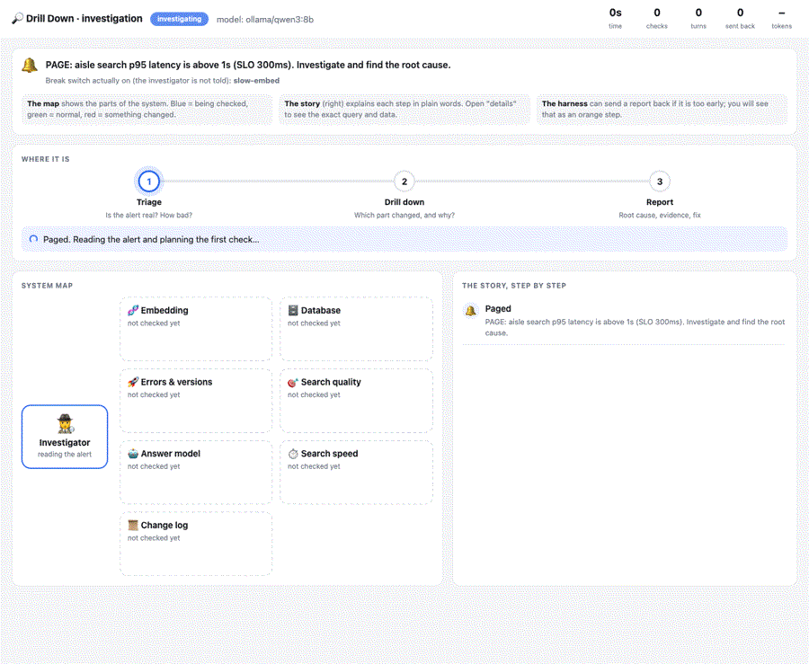

# Incident results

Five break switches, each investigated by [Drill Down Harness](https://github.com/arsaljamal/drill-down-harness)
on a laptop with a **small local model (qwen3:8b via Ollama, no API key)**. The investigator gets only the
page text and read-only Grafana access (Prometheus, Loki). It is never told which switch is on.

Every run is saved as a replay in [`results/incidents/`](../results/incidents). Watch one:

```sh
drill replay --speed 3 results/incidents/2026-11-12-slow-embed.jsonl   # then open http://127.0.0.1:7072
```



## Latest run (2026-11-12), graded by hand

| Switch | Page | Root cause named by the investigator | Verdict | Time | Checks |
|---|---|---|---|---|---|
| `slow-embed` | latency | "embedding host maintenance window started (2.5 min ago) coincided with the latency spike" | ✅ correct | 148 s | 5 |
| `db-pool` | latency | the embedding step | ❌ wrong | 67 s | 9 |
| `model-mismatch` | relevance | database connection limit (an older event from a previous test) | ❌ wrong | 157 s | 5 |
| `bad-deploy` | errors | "rollout of version 1.4.1, 1.5 min ago", other changes mentioned as context | ✅ correct | 138 s | 5 |
| `llm-down` | ask | LLM endpoint change, but also blames a rollout | ⚠️ half | 137 s | 5 |

**2 of 5 correct, 1 half right.** The automatic grader in the control room marks the last four as
"mixed" because they mention more than one change; it is a rough guide, so results are checked by hand.

## What changed the score

| Step | Correct | What it fixed |
|---|---|---|
| Harness only (system prompt, Grafana MCP) | 0 of 3 | Empty answers: Ollama's default 4K context silently cut the instructions. Fixed with a 32K context. |
| + report gate + runbook queries | 1 of 5 | The model stopped reporting after one query, and wrote broken PromQL/LogQL. |
| + `series` lens (metric series summarised: "rose from 0.02 to 2.4, 3 min ago") | 1 of 5 | It read long number lists wrong (blamed the database when embedding had jumped). |
| + `logs` lens (log lines with their age: "2.5 min ago: ...") | **2 of 5 + 1 half** | It can now match "latency rose 2 min ago" to "event 2.5 min ago". |

## Why it still fails

Every test runs on the same service, so the logs hold change events from earlier tests too. A small model
sees several "config reloaded" and "rollout" lines and either picks the wrong one or lists them all.
Next steps:

1. **A correlation step in the harness:** rank change events by how close they are to the moment the symptom
   started, before the model reads them.
2. **A stronger model** for comparison (same harness, same incidents), to separate harness limits from model limits.
3. **Clean slate per test:** restart the service between incidents so each starts with a quiet log.

## How it is graded

The control room grades automatically by matching the report's *Root cause* section against the switch that
was on, and marks it *mixed* when other causes are named too. Keyword matching cannot judge a report fully, so
every published verdict above was checked by reading the report.
